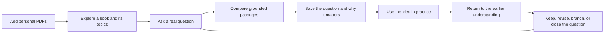
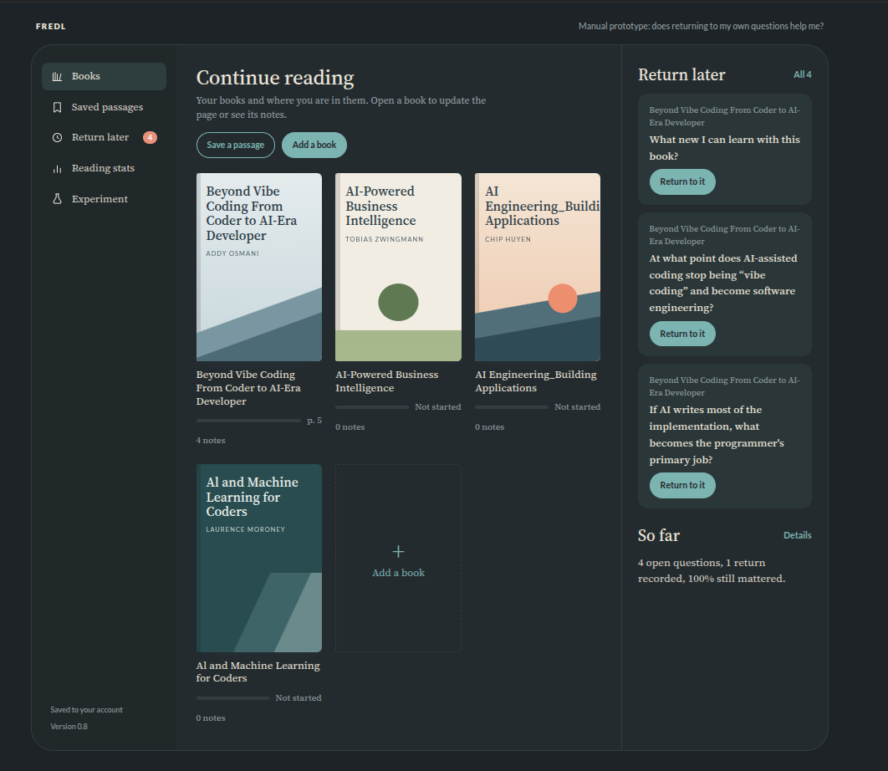
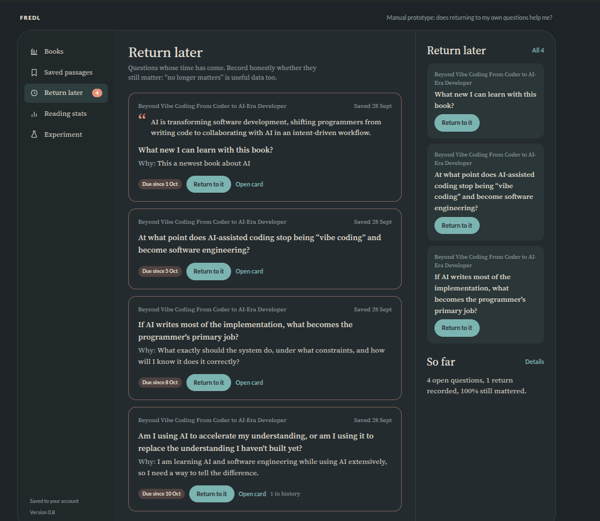
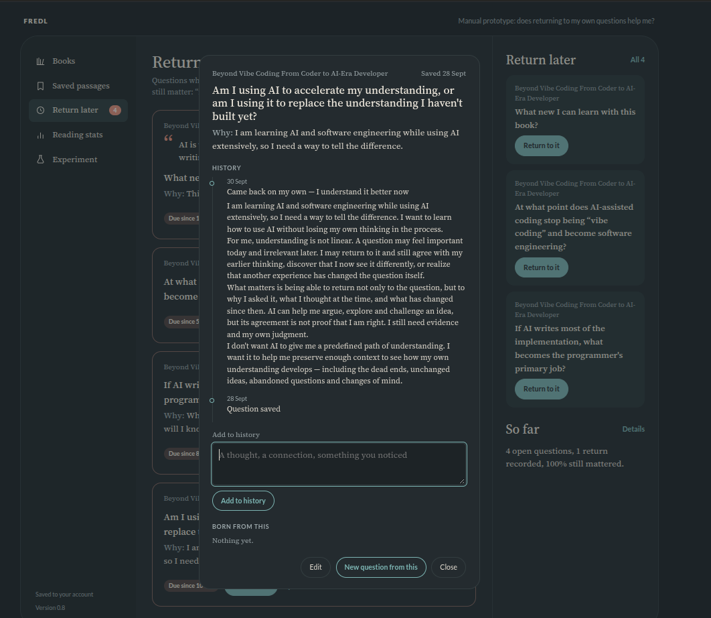

# FREDL

**FREDL helps you return not only to what you read, but to why it mattered.**

FREDL is an AI-assisted learning system for technical, scientific, and
educational materials. Its first intended user is its developer, who is
studying programming and AI engineering. The longer-term ambition is to
support learning across other disciplines, subject to future validation.

It is built around the questions that bring someone to a source, why a question
mattered, and what changed after applying an idea. Source-grounded explanations,
verifiable book/page provenance, and inspection of original sources are core
requirements. FREDL is not a general-purpose PDF reader or fiction-reading
application.

> [!IMPORTANT]
> FREDL is at an early research and development stage. A manual prototype under
> founder-led testing, a verified retrieval foundation, a local PDF ingestion
> pipeline, and a historical single-book evaluation exist today. Technical PDF
> validation covers four books. A private package of 22 candidate questions has
> human approval, but its multi-book evaluation contract, record judgments and
> new baselines are not complete. General PDF compatibility, the production
> frontend and personal learning memory remain unimplemented or unverified.

## Why FREDL

Technical and scientific books are rarely read in a straight line. Sometimes
someone reads an author from cover to cover. More often, a real question leads
to one chapter, one explanation, or one piece of code because a project needs
an answer now.

Months later, the important context is easy to lose:

- Where did this idea come from?
- Why was I looking for it?
- Which project needed it?
- What did I implement?
- Did it work?
- What would I do differently now?

Most reading tools preserve documents, highlights, or completion. FREDL is
designed to preserve the reader's path from a question to an experience.

Its central memory is not an isolated quote. It is the relationship between a
question, **why the question mattered**, the supporting source, and what the
reader later learned from applying it.

## The Product Idea

FREDL is intended to connect two searchable spaces:

1. **The library** — user-provided PDFs, their topics, exact passages, and the
   relationships between explanations in different books.
2. **The learning memory** — the user's questions, reasons, notes, returns,
   decisions, and later reflections.

The long-term experience is designed around a simple loop:



The user remains in control. FREDL may retrieve, compare, suggest, and ask, but
only the user decides whether a question is resolved or their understanding has
changed.

## What Returning Means

A return is not a quiz and it is not a generic spaced-repetition card. FREDL
brings back the user's own context:

- the original question;
- why it arose at that moment;
- the book and exact supporting passage;
- what the user previously thought;
- what happened after the idea was applied;
- any new question that grew from it.

The first prototype tests six lightweight reactions:

- still think the same;
- understand it better;
- think differently now;
- want to reread the source;
- found the answer;
- no longer interested.

There are no reading percentages, mandatory streaks, or penalties for not
returning. Different books and subjects need different rhythms. The first
experiment lets the user choose when to return; adaptive timing remains a
hypothesis to test later.

## Manual Prototype

The current manual prototype is version 0.8. It explores the product behavior
before a production frontend is built. It includes a small personal library,
saved thought cards, `Why`, `Born from`, branching questions, return history,
statistics, and export.



*The library view keeps books and open questions together without treating
completion as the goal.*



*The return queue shows the original question and why it mattered.*



*A thought keeps its history and can branch into a new question.*

The prototype does not yet include topic directions, side-by-side passages from
different books, source preference feedback, or the complete “then and now”
view. It must not be confused with the future production application.

### Founder-led validation

The prototype is currently tested only by FREDL's founder, using her own books,
questions, and engineering work. The purpose is to learn whether returning to
the original question and its context is genuinely useful before investing in
the complete application.

A positive result will be a signal to continue, not proof that the approach
works for everyone. A negative result will be equally valuable because it can
change the product before the prototype becomes infrastructure. Wider testing
will be considered only after the founder experiment produces evidence worth
carrying forward.

## Current Project State

| Area | Current state |
| --- | --- |
| Product concept | Defined and being refined through use |
| Manual prototype | Version 0.8 in founder-led self-testing |
| Retrieval foundation | Implemented for code, text, and local PDF index records |
| Code and Markdown ingestion | Implemented |
| PDF ingestion and page provenance | Local utilities checked on four text-based technical books; complex layouts have explicit limitations |
| PDF section-aware chunking | Verified headings, outline-without-destinations fallback, unresolved structural status and exact physical-page provenance |
| PDF retrieval evaluation | Historical single-book baselines; current corpus and evaluation contract implemented, new baselines pending |
| Answerability check | Local experimental runner with separate metrics; not part of a product reading flow |
| Multi-book PDF evaluation | 22 human-approved private candidates; no frozen Golden Set, multi-book contract, record judgments or new baselines |
| Production frontend | Not implemented |
| Learning-memory storage | Designed conceptually; not implemented |
| Adaptive resurfacing | Research hypothesis; not implemented |
| External model integrations | Future direction; not implemented |

FREDL is also part of its founder's own engineering development. She is using
the prototype to study from technical books while building the retrieval,
memory, and product systems that the project requires. Its portfolio value
comes from that documented work: real decisions, implementation, measurement,
and revision as the evidence changes.

## Retrieval and PDF Foundation Available Today

The repository contains a tested retrieval foundation for code, Markdown,
plain text, and local PDFs. PDF files remain in a user-controlled library
outside the repository. The current pipeline prepares exact, index-neutral PDF
records locally; it does not upload a book or silently send its text to an
external model.

| Capability | Current implementation |
| --- | --- |
| Lexical retrieval | Custom two-field BM25 with bounded reranking |
| Exact evidence | Project-relative paths and character ranges |
| Code ingestion | AST-aware Python chunking |
| Text ingestion | Structure-aware Markdown and plain-text chunking |
| PDF extraction | Physical pages, positioned text, font metadata, and observable page classification |
| PDF reading text | Margin removal preserves raw line separators; cross-page reconstruction keeps source provenance |
| PDF structure | Verified outline matching, layout-supported fallback without destinations, and explicit unresolved boundaries |
| PDF chunking | Section-aware bounded chunks with balanced tails and stable identifiers |
| PDF provenance | Reading-flow ranges plus exact source ranges on every contributing physical page |
| PDF index records | Index-neutral local records with text and structural metadata kept separate |
| PDF retrieval corpus | Reversible P0/P1/P2 policies; navigation exclusion and searchable-text boilerplate masking without altering source records |
| Optional semantic search | Pinned CPU MiniLM embeddings |
| Optional hybrid search | Weighted Reciprocal Rank Fusion for documentation and PDF records |
| PDF evaluation | Canonical ordering, layered fingerprints, manifests, judgment migration, and ranked/context evidence-unit coverage |
| PDF neighbor context | Eligible touching records in the same known section interval; equal section titles alone are insufficient |
| Answerability experiment | Binary `ANSWERABLE` / `NOT_FOUND` decision with false refusals and false acceptances reported separately |
| Answer generation | Replaceable local model backend with citation validation |
| Interfaces | Python Fire CLI and local FastAPI server |
| Persistence | Corpus, pipeline, schema, and checksum validation |

Retrieval is evaluated separately from generation. The foundation keeps exact
source text separate from ranking metadata, rejects stale or incompatible
indexes, and treats an invalid generated citation as an error rather than
presenting an unsupported answer. Its earlier benchmark results are not used as
evidence for PDF quality.

PDF workflows use the separate `pdf_*` commands, not the general `index` or
API indexing path. Figures and formulas are not faithfully interpreted; tables,
footnotes and code can lose structure, and some PDFs already contain clipped
source content. Reliability reports expose findings without changing ranking.
See [PDF evaluation and CLI](docs/pdf-evaluation.md) for interfaces and limits.

### First PDF evaluation

The results below are historical, from the earlier corpus and evaluation
protocol. They cannot be directly compared with pending baselines after the
PDF extraction, corpus and evaluation-contract changes.

The first PDF evaluation uses one private technical book and 17 real
questions: 10 completely answerable, two partially answerable, and five hard
negatives whose terms appear in the book without supporting the requested
answer. Questions, labels, and book text stay outside the repository.

- Retrieval alone cannot refuse. On the first 16 questions, BM25 and MiniLM
  each found 60.4% of required passages in the top five on average;
  equal-weight hybrid fusion found 77.1%. With adjacent same-section context,
  hybrid retrieval covered every labelled evidence item for the answerable
  questions. No similarity score separated answerable questions from hard
  negatives.
- A separate answerability check therefore decides whether retrieved passages
  actually support an answer. A local Qwen3-4B model (Q4 quantization, run
  through llama.cpp outside FREDL's dependencies) classified all 17 cases
  correctly. Qwen3-1.7B, given the same context, accepted two of the five
  hard negatives as answerable.
- These results come from one book and five negatives. They select an
  experimental baseline; they do not establish general reliability. The
  reasoning and limits are recorded in
  [PD-002](docs/product-decisions.md#pd-002-require-direct-evidence-before-treating-retrieval-as-an-answer).

## Product Principles

- **The question belongs to the user.** A model may suggest that something is
  understood, but it cannot close or rewrite the question without confirmation.
- **Context matters more than collection.** FREDL preserves why a question was
  asked and what happened next, not only what was highlighted.
- **Sources stay visible.** Retrieved evidence must lead back to the exact book
  location. Generated explanations must be visually separate from source text.
- **Feedback is intentional.** A written or spoken reflection is stronger than
  a quick marker; a quick marker is stronger than passive behavior. Time on a
  page never proves attention or understanding.
- **Adaptation stays transparent.** A preference or suggestion should explain
  the events behind it and remain correctable by the user.
- **Learning stays non-linear.** FREDL preserves unchanged ideas, dead ends,
  abandoned questions, and changes of mind without forcing a universal path.
- **Models remain replaceable.** Future external model integrations should be
  selected and connected by the user, with an explicit boundary around the
  context they receive.

## Development Direction

The next work is deliberately narrower than the complete product vision.

### 1. Establish the next PDF evaluation

Four-book technical validation and PDF Tasks 1–5 are implemented. Task 6 has
22 human-reviewed candidates accepted in a private package. Candidate approval
does not freeze a Golden Set, assign record relevance, or establish retrieval
or answerability quality. The remaining evaluation work requires separate scope
and approval:

- define a versioned multi-book contract for evidence combinations and limits;
- review record relevance and sufficient alternative evidence;
- measure retrieval, evidence sufficiency and answerability separately;
- report per-book and cross-book results without reusing historical scores as
  current baselines.

Broader multimodal support, OCR and faithful complex-layout extraction remain
future work. Four-book validation does not establish general PDF compatibility.

### 2. First production user flow

- add a PDF;
- see an overview of the book and its topics;
- ask a question;
- compare exact passages;
- save the question, its reason, and its source;
- return to it and record what changed.

### 3. Learning memory

- store questions, intents, topics, sources, and events as separate entities;
- keep explicit notes, quick markers, and passive observations distinguishable;
- derive source preferences from events rather than storing an unexplained
  score;
- make every inferred preference visible and correctable.

### 4. Later experiments

- compare explanations from different books;
- test calm, adaptive resurfacing without streaks or engagement pressure;
- explore alternative explanations through examples, diagrams, images, and
  step-by-step reasoning;
- connect user-selected model providers;
- expose selected library and memory capabilities through MCP;
- generate practical exercises from verified context.

These are hypotheses and planned experiments, not release promises.

## Development

FREDL is currently a research repository rather than a finished application.
The Python foundation can be installed and checked locally with Python 3.10 or
later and `uv`.

Install the locked environment:

```bash
make install
```

```bash
make run          # show the CLI
make debug        # run the CLI through pdb
make test         # run pytest
make lint         # run project lint and type checks
make lint-strict  # run flake8 and strict mypy
make clean        # remove local Python check caches
```

Optional local Git hooks are defined in `.pre-commit-config.yaml`. They are
not part of the locked environment; install the `pre-commit` tool separately,
then run `pre-commit install --hook-type pre-commit --hook-type pre-push`.
Commits check whitespace, file endings, YAML/TOML, large files, private file
names and flake8; pushes also run `make lint-strict` and `make test`. The
private-file check (`scripts/check_private_files.py`) inspects names and paths
only. It does not detect book text copied into an allowed file.

## Documentation

- [`docs/product-direction.md`](docs/product-direction.md) explains the learning
  problem, the product loop, and the signals FREDL intends to test.
- [`docs/product-decisions.md`](docs/product-decisions.md) records accepted
  product decisions, their evidence, and the conditions for revisiting them.
- [`docs/technical-foundation.md`](docs/technical-foundation.md) records which
  parts of the current retrieval code are reusable and what PDF support must
  prove next.
- [`docs/pdf-evaluation.md`](docs/pdf-evaluation.md) describes the existing
  single-book evaluation utilities, CLI commands and multi-book review boundary.

## Verification

On 15 October 2026, `make test` passed **881 automated tests** locally with
Python 3.13. CI targets Python 3.10. The supported checks are:

```text
make test
make lint
make lint-strict
```

The local test run reports one third-party deprecation warning from Starlette's
AnyIO compatibility alias.

## License

FREDL is available under the [MIT License](LICENSE).
